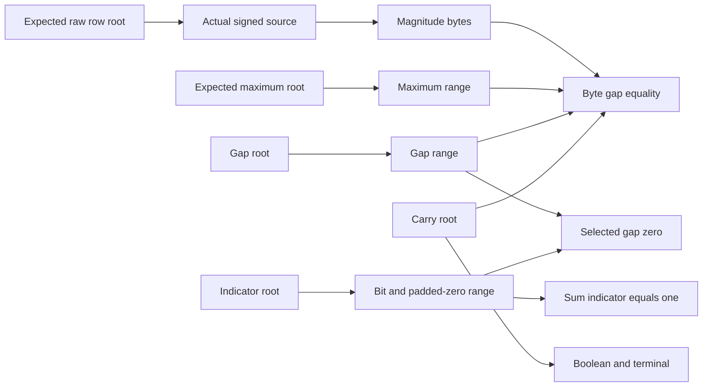

# Consumed attained magnitude — Q26 / Q31

Status: implemented research for RFC-0004 §5.5 / Draft A3/A8, using
existing A1/A3 and range consumers. E5-03 and downstream original criteria
remain open/blocked. No private proof or production cut is admitted.

Question: can the actual signed row source prove that a separately expected
maximum magnitude bounds every real element and is attained, with work linear
in row bytes and without a plaintext maximum oracle in verification? The
properties are source ownership, integer comparison, attainment and padding.
Cost terms are c_a/c_sc/c_lu/T_misc; no measured constant or weight-pass change.

Kill criterion: stop if a below/above maximum, padded selection, missing/duplicate
selection, false carry or substituted original passes; if any claim lacks its
actual consumer or static faithfulness; or if the verifier recomputes max(input).

Candidate derives from the existing closed dynamic row_bounds.Spec. Wide rows
use signed16 and H=32768; gated rows use signed32 and H=2^30. The magnitude
maximum and gaps have exact caps H. Source width B=2^b is2/4 bytes. N=2^a is
the padded row size. The actual signed-source consumer limits this research
instance to at most2048 real elements; larger shapes reject before payloads,
without changing the closed row schema's production support requirements.

Authenticate independently expected raw input and maximum roots. An actual
signed consumer binds magnitudes; actual wide ranges prove M<=H, gaps G_i<=H,
and indicator E_i in {0,1}. Original padded magnitudes, gaps and indicators
have cap zero. A rooted carry vector stores C1..CB, with public C0=0.

Consume four A3 identities in fixed order:

1. MagnitudeGap: mag_byte + gap_byte + Cin - masked_M_byte - 256*Cout =0,
   dimension a+b, degree1. masked_M is the actual M byte broadcast on real
   positions and zero on padded positions, not an independently supplied table.
2. CarryBoolean: C(C-1)=0, dimension a+b, degree2.
3. TerminalCarry: CB=0, dimension a, degree1.
4. Attainment: E_broadcast*gap_byte=0, dimension a+b, degree2.

Then degree1 A1 checks sum_i E_i=1 and consumes its actual original final.
Since N<=2048
=2 outside the reserved span. Magnitude, gap, indicator
and carry use base+1..4; views use base+8..11. Signed identity is128*identity+1;
its nested range spaces lie inside the reservation. Maximum/gap/indicator wide
ids are1024*identity+32..34. Parent A3 ids are4096*identity+256..259 and A1 is
4096*identity+260, disjoint from nested invocation ids. Metadata, capacity and
all static certificates derive before payload work. The most permissive valid
namespace remains inside u64, without wrapping or borrowing external ids.

The context prefix is `stele/research/q26/attained-magnitude/v1` followed by
NUL, version/field/repetition bytes, three little-endian u64 ids, kind byte,
u32 dimension and fraction byte. It binds six roots in raw/magnitude/maximum/
gap/indicator/carry order and four completed verified states in input/maximum/
gap/indicator order before parent challenges. Dynamic mode and scale0 are fixed
by validation. The parent proof has those four children, four auxiliary roots,
the carry vector, four A3 proofs and one A1 proof. Every final is absorbed.

## Faithfulness and accounting

All magnitude/gap/maximum bytes are actually range-checked. With Boolean carries,
each equality has integer sides at most511 and 2*511<p. Zero incoming/terminal
carries telescope to `magnitude_i + gap_i = M`. Since gaps are nonnegative,
M bounds all real magnitudes. Actual indicator bits have sum1 with N<p, and
padded bits vanish; therefore exactly one real gap is zero. Together these
prove M is attained. Gated H=2^30 is enforced by the maximum cap and dominance,
even though the signed32 source alone permits a larger magnitude. No whole-word
gated equality is assumed faithful in M31. All-zero inputs and any tied real
attainment are valid. Deterministic honest selection uses the first maximum.

Each lookup retains identity `[(2^m+255)/|K|]^r` and reduction
`r*(F(m)+F(8)+3m)/|K|`, F(m)=3m(m-1)/2+2m. The six dimensions above include
every actual nested range. No reduction loss is raised to the repetition count.
The total A3 numerator is71a+48b+9; A1 adds a. Total A3/A1 draws, excluding
lookup schedules, are30a+19b+4 ZeroWeight and31a+19b+4 Sumcheck. All nine parent
A3 finals and the one A1 final have actual consumers, alongside every child
claim. Full-vector binding, FS/H and joint private composition are additional.

## Reproduction and adversarial evidence

Run `uv run --locked --script research/cqis-bounds/check_attained_magnitude.py`.
The tests-first run failed with the missing module. Seed2673 covers10000 closed
wide/gated layouts and196636 byte cells against independent exact integer
maximum, gap, tie, padding and carry calculations. Its SHA-256 is
`ba9c1d2840b9ade277b5f64a3844b25b7c567946f79c023feafa34698039fbc8`.
The complete proof matrix covers QM31/OM31, single/paired lookups, zero and
ragged tied endpoints, with exact ledger terms, draw counts and final claims.
Its frozen proof-state SHA-256 is
`3e44bd103f327780f275727aa5f3601dc87718c21975c189881340b5207ccc74`.

Controls change each raw/magnitude/maximum/gap/indicator/carry original,
preserve column equations while changing each of its five finals, replace a
Boolean final by another root, and alter an inactive attainment factor. A
genuine alternative onehot sum proof must reject `OneHot:ClaimMismatch` at the
original consumer. Below-maximum claims fail MagnitudeGap; nonattained claims
fail Attainment; absent/duplicate selections fail OneHot. Selecting only padding
satisfies every parent equation but fails `Indicator:TerminalCarry:RoundSumMismatch`.
The p-alias satisfies every relation except carry Booleanity and fails there.
Signed input H+1 and M=H+1 satisfy all parent equations but the actual maximum
range rejects `Maximum:TerminalCarry:FinalEvaluationMismatch`. Shape, canonical
field, static capacity and namespace controls are included. Small parent proofs
are compared byte-for-byte with the existing naive A3 oracle.

Work is linear in NB for added witness, parent prover and exact view consumers,
plus all inherited lookup/range/hash work. The full-opening reference verifier
is not a production succinctness or throughput result. No measured constant,
benchmark number or extra inference weight pass is claimed. No native code or
production no_std path changes; research controls earn no native NC credit.

Recommendation: continue Q26/Q31 with actual dynamic scale and row-code consumers,
then model-owned routing, native lowering, private PCS/ZK and independent review.
This consumer proves existential attainment; a separately committed index and
private coefficient semantics require their own consumers. The original row
schema supports larger shapes than this bounded research adapter. E5-03 remains
blocked with its original criteria; this evidence does not accept Draft A3/A8.
