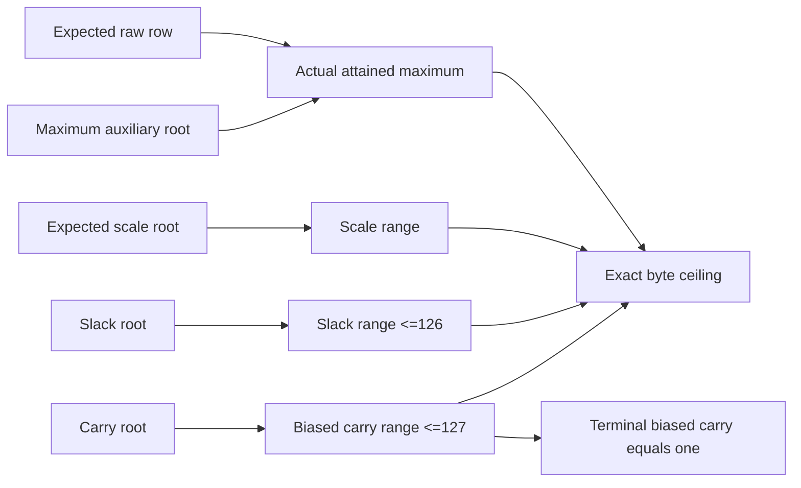

# Consumed dynamic row scale — Q26 / Q31

Status: implemented research for RFC-0004 §5.5 / Draft A3/A8. Original
E5-03 and downstream criteria remain blocked/open; no production cut or private
proof is admitted. Apply cqis-numerics, gkr-reduction-author, rfc-author and
soundness-auditor with same-author review, not independent audit.

Question: can the actual attained-magnitude consumer prove the independently
expected dynamic scale S=ceil(M/127), including the all-zero row, with linear
byte work and no plaintext verifier maximum/division? Cost/security terms are
c_a/c_sc/c_lu/T_misc, source association, static faithfulness and exact ceiling.
Kill criterion: any wrong scale, slack127, substituted source, carry or final
passes; a claim lacks an actual consumer; or whole-word field arithmetic replaces
the static integer argument. Stop rather than admit an unaccounted protocol.

Use only closed dynamic row_bounds.Spec, same wide/gated bounds and at most2048
elements as the attained-magnitude adapter. N=2^a; magnitude bytes B=2^b in{2,4}.
Fully consume that proof, an actual scale range at the closed scale_max, an
actual slack range0..126, and a B-element biased-carry range0..127. M has an
explicit auxiliary root passed to the actual maximum proof; raw input and scale
roots are independently expected. No supplied source map or optional consumer.

Prove 127*S=M+slack. The carry is signed: with S=256, M=32386, slack=126,
the low byte requires carry -1 because M_low+slack=256. Store T=C+1 instead,
with public T0=1 and terminal TB=1. For each byte j, consume degree1 A3:

    127*S_j + T_j + 255 - M_j - slack_j - 256*T_(j+1) = 0.

Here slack is its actual one-byte source at j=0 and public zero on higher
planes. Incoming T is public1 followed by the authenticated prefix; all other
operands are actual range-checked bytes. T in[0,127] gives integer side bounds
32767 and32893, so 2*32893<p. A second degree1 dimension0 A3 consumes TB-1=0.
These are fixed full-vector views; every emitted final is consumed even when
a coefficient is zero or dimension is zero.

Honest carries follow Cnext=(127*Sbyte+Cprev-Mbyte-slackbyte)/256. Exact global
equality makes each numerator divisible by256, and the bounds inductively give
C in[-1,126]. Initial/final C=0 give exact integer telescoping. With slack in
[0,126], 127*S=M+slack uniquely gives ceil(M/127); M=0 iff S=0. This does not
yet prove a separately committed nonzero flag, predecessor or row output codes.

The own A3 numerator is2b, with b draws each of ZeroWeight/Sumcheck. Three new
wide ranges contribute7b+0+9b; total A3 including attained magnitude becomes
71a+66b+9, retaining its separate A1 numerator a. Preserve the six inherited
lookup identities plus dimensions b+1,1,b+1 for scale/slack/carry, each with its
own repetition and reduction loss. Five roots and four verified child states
precede the parent A3 invocations; no new label, retry or inverted challenge.
Binding, FS/H and private composition remain separate.

Candidate namespace: parent identity<2^40 reserves base=2^63+2^22*identity.
External raw/scale ids are distinct u64>=2 outside that span. M/slack/carry
roots use base+1..3; incoming/slack/terminal views use base+8..10. The maximum
child identity is64*identity+1; scale/slack/carry wide ids are65536*identity+
4096..4098. Parent A3 ids are262144*identity+32768..32769, separate from all
nested spaces. Metadata and every capacity derive before payloads.

Tests first: exact integer corpus, all-zero and 127-multiple boundaries, the
negative-carry case, both fields/repetitions, malformed/canonical field controls,
wrong expected sources, coherent wrong scale with valid child ranges, and the
false zero-row S1/slack127 statement whose arithmetic holds but actual slack
range must reject. Check every source/view final and nested account; compare
small parent proofs with the naive A3 oracle. No performance measurement yet.

## Implemented source flow

`dynamic_scale.py` fully verifies the attained-magnitude proof using expected
raw input and explicit maximum root. Scale, slack and carry each have an actual
wide-range consumer. Parent verification then consumes both A3 relations and
all six original/view finals. No maximum or scale division is recomputed by
the verifier; no caller-supplied state substitutes for child verification.

The source schema fixes a dynamic row with scale0 in its metadata; that fixed
configuration field does not supply the claimed runtime scale. Runtime scale
has an independently expected root and a static upper bound from the closed
schema. Scale and maximum have exactly B byte planes, including high zeros;
slack has one. Biased carries are B one-byte words, not a whole integer carry.
All views use these authenticated words in order. An input fraction is context
metadata; no fraction-dependent rounding is inserted into the ceiling equation.

The prefix `stele/research/q26/dynamic-scale/v1` plus NUL precedes version, field,
repetition, parent/source/output ids, kind, dimension and fraction in explicit
little-endian encoding. Bound roots are raw, maximum, scale, slack, carry;
verified child states are maximum, scale, slack, carry. The proof contains those
four children, three auxiliary roots and exactly two A3 proofs. Parent identity
spaces listed above remain separate from all nested ranges and invocations.
Schema, capacities and namespaces are validated before payloads; the maximum
identity and2048-element metadata boundary are exercised without proving a large
instance. No production commitment codec or extra tensor cut is defined here.

## Integer argument and costs

After actual range verification, let C_j=T_j-1. Each byte equation is faithful
under the static side bounds. Multiply column j by256^j and sum: initial/final
C=0 cancel the carry terms, yielding integer127*S=M+slack. Nonnegative integers
and slack<=126 give S=ceil(M/127) uniquely. If S=0, M=slack=0; if M=0, S=0
because no positive multiple of127 fits the slack interval. This result uses
the separately consumed attained maximum, not a maximum recomputed from reveals.

For honest witnesses, integer global equality ensures each successive numerator
is divisible by256. With C in[-1,126], the numerator lies in[-382,32511]; its
integer multiple of256 therefore gives Cnext in[-1,126]. The signed carry case
is required for valid data, and the stored offset keeps all rooted words unsigned.
The corpus independently reconstructs every column with ordinary integer bytes.

Three extra lookup identities retain their own repetitions and reductions;
their terms are not hidden inside the inherited account. Full A3 numerator is
71a+66b+9 and inherited A1 adds a. Total A3/A1 draw counts excluding lookup
schedules are30a+27b+4 ZeroWeight and31a+27b+4 Sumcheck. The tests replay each
of the nine lookup terms, both parent records, all six finals and total draws.
Exact full-vector consumers add no algebraic loss conditional on binding;
FS/H and joint private composition remain additional.

Added ceiling witness and A3 work are O(B), after the O(NB) attained-magnitude
consumer, plus complete nested range/lookup/hash work. This scalar constant127
identity needs no fresh product-polynomial challenge. No measured improvement,
benchmark constant, weight-pass change or production verifier cost is claimed.
The revealing reference consumers are not a private inference protocol.

## Evidence and continuation

Run `uv run --locked --script research/cqis-bounds/check_dynamic_scale.py`.
The tests-first run failed with the missing module. Seed2674 covers10000 cases,
30000 byte columns and1410 negative-carry cases. The exact integer corpus SHA-256
is `d631f4eba362103b73969c4392dbcf337a0ed0ccf7826261b9621c58fdff0775`.
Its fixed prefix includes0,1,126,127,128,254,255,256,32385,32386 and H to
exercise exact multiples of127 and their neighboring ceiling boundaries.
The complete proof matrix covers both fields/repetitions and all-zero/ragged
tied endpoint rows with exact nested accounting. The negative-carry example
also has a complete proof and naive A3 parity check.
The frozen proof-state SHA-256 is
`a035e913f4b9fa78dc37132ab424172276b11735bcbb2363e93598a54fcad49a`.

Controls change raw input, maximum, scale, slack and carry sources individually.
Each of the five column finals is changed while preserving the linear equation;
actual ClaimMismatch rejects. Wrong terminal value rejects even at dimension0.
Valid alternative scale ranges255/257 attached to the scale256 statement reject
ScaleCeiling. A zero-row scale1/slack127 proof satisfies every parent equation
but rejects `Slack:TerminalCarry:FinalEvaluationMismatch`. Malformed proof shapes,
roots, boolean-as-field limbs, metadata, collisions and excess capacity reject.
Research controls earn no native NC credit; production code remains unchanged.

Recommendation: continue Q26/Q31 with actual row output-code and zero-scale
relations, model-owned source routing, native lowering, private PCS/ZK/FS and
independent review. This statement does not bind a separate nonzero flag,
predecessor or committed index. Existing original task criteria and Draft A3/A8
status remain unchanged; the source schema's larger production shapes are not
admitted by this capacity-limited revealing adapter.
