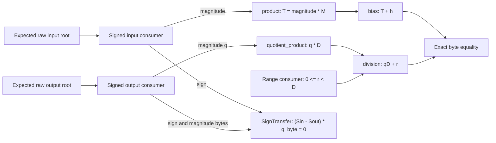

# Consumed scalar Requant — Q26 / Q31

Status: preimplementation research for RFC-0004 A1 and Draft A3. Original
E5-03/E7 criteria remain blocked/open; no native NC credit or private admission.

Question: can the closed scalar Requant semantics consume actual signed input
and output byte sources, multiplication, biased division, remainder and source
relationships without a plaintext integer arithmetic oracle in the verifier?
The properties at stake are source faithfulness, signed ties-away rounding,
zero canonicality, range enforcement and integer division uniqueness. Symbolic
cost terms are c_a/c_sc/c_lu/T_misc; no benchmark or weight-pass change.

Kill criterion: stop if an independently valid wrong-source subproof can splice
in; if a public constant, high byte, sign, remainder bound or output can change
without rejection; if verification recomputes the integer product/division; or
if exact challenge accounting, static bounds or canonical source routing fail.

Candidate uses the existing requant.Spec(M,e,bits) and its closed records:
M in [1,65535], e in [0,62], bits8/16. D=2^e, h=D/2 when e>0 else0.
Actual signed-source consumers bind int32 input and int8/16 output to magnitude
and canonical sign. Four actual limb-product consumers implement product,
bias, quotient_product and division using the existing closed column schemas.
Input_lhs/input_rhs are replaced by the stronger actual signed-source consumer;
no accepted RFC-0022 record format changes. An actual wide range enforces r<D.

Bind product operands to input magnitude and public M. Bind bias operands to
the authenticated product output and public h, both multiplied by public1.
Bind quotient_product to actual output magnitude and public D. Bind division
to its authenticated output and the separately bounded remainder, again times1.
Compare the bias and division results by exact zero-extended byte equality.
This gives |acc|M+h=qD+r, 0<=r<D. A degree2 A3 relation on every quotient byte
checks (input_sign-output_sign)*q_byte=0. This permits a negative input rounding
to canonical output zero; for q>0 it requires the signs to agree.

Every routed byte comes from a verified original or a static public constant.
Derive expected limb input roots in the complete plane-major layout. Never trim
to a cap's nominal digit count: a source with a nonzero higher byte must reach
the actual whole-input range, or reject if it exceeds the source layout. Add
only fixed zero extension, reject nonzero excess tails, and compare all live
result bytes. Full-vector root/equality consumers add no algebraic challenge.

Namespace candidate: parent id<2^42 reserves base=2^63+2^20*id through +2^20-1;
external raw input/output ids are distinct and outside. Signed ids2048id+1/+2
use auxiliary magnitude idsbase+1/+2. Product ids256id+16+j (j0..3) use source
idsbase+16+2j and result idsbase+17+2j. Remainder wide id16384id+32 has source
base+3. Child auxiliary spans are disjoint and statically checked by derivation.

All nested consumers fully verify. The parent binds expected schema, source ids,
all actual roots and completed child states before final sign A3. With output
B=2^b bytes, sign A3 adds 3b/|K| and b draws of each A3 label; zero-dimensional
instances retain their absorbs/records. Sum every signed/range/product receipt's
loss, including all four independent product identities and all lookup terms.
Do not square nonidentity errors or claim hash/FS/private composition for free.

All roots remain revealing canonical-u32 byte-word research roots, not physical
checkpoint/model roots or admitted production cuts. Production stacking, native
plan/codec, source ownership, private PCS/ZK and the full joint security argument
remain required. Continue Q26/Q31 only if the complete controls pass.

## Implemented source and transcript contract

Spec contains the expected requant.Spec, parent identity, external source/output
ids and repetitions 1/2; field degree is 4/8. The namespace above is implemented.
The two signed consumers each have one real row. The remainder is one real
wide word. Product counts are 1,2,1,2 in the fixed order above. All capacities,
caps and namespace checks derive from the expected schema before proof access.
The caller supplies only the independently expected input and output raw roots.

The proof object contains input/output signed proofs, a remainder range proof,
products keyed by the four exact role names, and sign A3. Auxiliary magnitude,
remainder and result roots are derived from the canonical opened arrays. The
full verifier checks every nested proof and each expected original root. Operand
roots are computed from source byte vectors, static constants, real-row order
and zero padding. A product output cannot replace its operand or another role;
no prover-supplied source map or expected-root list is accepted.

The source router includes every byte through the child's full P-plane layout,
even when a static coordinate cap has fewer digits. Extra bytes beyond P must
all be zero. This matters when quotient_max=0: discarding a high quotient byte
would permit an unrelated nonzero signed output to use a zero-quotient proof.
The byte router does no multiplication, division or signed decoding.

The parent context is `stele/research/q26/requant-consumer/v1\0`, u8 version 1,
degree, repetitions; u64 identity, source, output; u16 mantissa; u8 shift, bits,
all little-endian. Append 13 roots: external raw input/output, input/output
magnitudes, remainder, then each product's derived source/result roots in role
order. Append seven completed verified states: input, output, remainder and
the four products. Each root/state is 32 bytes. Children keep their original
domains, exact contexts and complete challenge schedules; the parent changes
none of their proof formats or accounting.

Sign A3 id is 2^20*identity+900000, k=0, m=log2(bits/8), with virtual broadcast
input/output sign idsbase+32/+33 and actual output magnitude idbase+2. Its
polynomial is Sin*Qbyte-Sout*Qbyte. Every final is consumed against the exact
authenticated sign/magnitude views at its emitted point, including Q=0. Its
context precedes ZeroWeight, and all A3 finals/zero-dimensional records remain.

The exact byte equality of bias and division results checks their full canonical
vectors with fixed zero extension. Their actual output ranges guarantee that
every digit is a byte and all padding is zero. This is a full-reveal source
equality consumer, not a field equality of wide values or an arithmetic oracle.
Given actual nested proofs it establishes |acc|M+h=qD+r as an integer. Since
D>0 and 0<=r<D, q is the unique floor quotient. Canonical signed input/output
proofs plus sign A3 then establish A1 signed ties-away rounding. If q=0, the
output signed consumer forces canonical zero even for a negative input; if
q>0, at least one nonzero quotient byte forces sign agreement. Actual signed
output range enforces overflow rejection, including the asymmetric endpoint.

## Complete conditional accounting and costs

There are 19 nested lookup identities: three per signed consumer, one remainder,
and three per byte product. Each keeps its own numerator/repetition and all
lookup reduction terms. No error other than an identity's own error is raised
to its repetition count. The four products contribute sum(Kj-1)/|K| identity
loss and sum(2aj+4hj)/|K| A1 loss, with their original fresh rho draws.

Let bo=log2(bits/8), br=log2(remainder byte planes), bj=log2(product input byte
planes), gj=log2(product output/carry size). Counts give aj=0,1,0,1. Input signed
A3 contributes 61, output 9+26bo, remainder 7br, each product 11aj+31+9bj+18gj,
and final sign 3bo. Total A3 numerator is
216+29bo+7br+sum_j(9bj+18gj). The sign check adds bo draws of each A3 label,
with no new label or retry. All original consumer claims remain mandatory.
Full-root/equality routing adds no algebraic challenge, conditional on binding.
Hash binding, FS/H and joint private/model-source composition remain separate.

The parent adds O(total routed byte cells) work/storage to the complete existing
signed/range/product consumer costs; it never recomputes the integer product or
quotient in verification. Existing revealing reference verifiers remain
nonsuccinct. There is no throughput measurement, changed cost-model constant,
production cut or new physical weight pass. Witness generation may compute the
integer forward operation; it is not the acceptance oracle.

## Reproducible checks

Run `uv run --locked --script research/cqis-bounds/check_requant_consumer.py`.
The tests preceded implementation; the first run failed for the missing module.
The independent integer rounding corpus uses seed 2672 and 10000 cases: 4688 fit
the target format, 5312 reject overflow. It checks byte source routing against
the original limb layout and has checksum
`11ae98c900c076ed8c2fddc047a1fbb4da8c5a72576730f406e7e746e8ef5acf`.
Maximum parent identity and disjoint child namespaces are checked separately.

The proof matrix covers both fields/repetitions and four semantic cases: shift0
at a negative target endpoint, negative rounding to zero, a positive half tie,
and INT_MIN with mantissa 65535 / shift 32 producing the negative int16 endpoint.
All 16 initial proofs passed, with frozen complete proof-state checksum
`6e0a8c395c155a39f8568d6c4c4d22c130bf4ecb6d5c88e940b0a212a5a2a55e`.
Controls splice independently valid proofs with wrong magnitudes, mantissa,
bias, divisor, scaled quotient or remainder; change the output sign; preserve a
nonzero high quotient byte under static quotient cap0; and separate the two
integer results. Actual wrapped range proofs test oversized remainders for
shift0 and a negative half tie, while all product/source equalities can hold.
Both public unit factors in each sum are tampered separately, including the
factor multiplying a zero remainder. All three inactive zero-quotient final
claims are tampered separately and retain actual consumers. These checks
earn no original NC-0100/0101/0109 credit or native inference admission.
