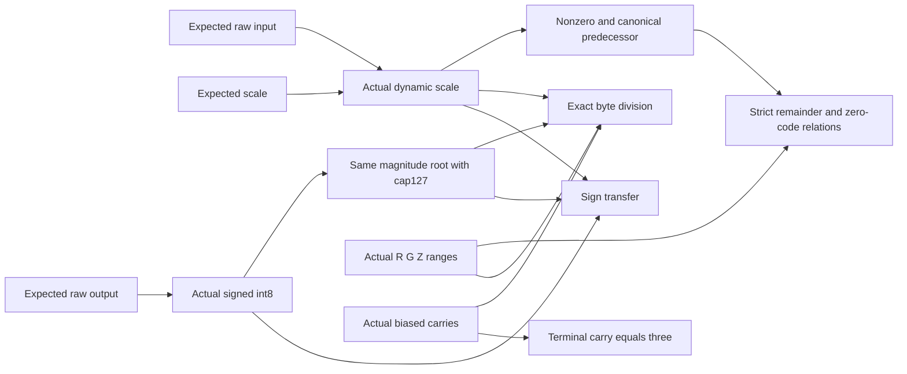

# Consumed dynamic row codes — Q26 / Q31

Status: implemented research for RFC-0004 §5.5 / Draft A3/A8. E5-03 and
downstream original criteria remain blocked/open. No production cut or private
proof is admitted. Same-author skill review is not independent audit.

Question: can the actual dynamic-scale proof establish an independently expected
signed int8 row under nearest/ties-away division, including scale0, with work
linear in row bytes and no plaintext verifier maximum or division? Cost/security
terms are c_a/c_sc/c_lu/T_misc, shared sources, signed rounding, zero semantics
and static faithfulness. Kill criterion: wrong code/sign/scale, zero-scale free
output, excessive remainder, source substitution, padding or false carry passes;
any final lacks its actual consumer; or whole-word M31 arithmetic hides overflow.

Consume the dynamic-scale proof and signed int8 output with independent expected
raw input, scale and output roots. The output magnitude Q gets an additional
actual cap127 range on the same source root. Further actual wide ranges prove
remainder R, gap G<=2*Smax-1; zero gap Z<=127; nonzero N in{0,1}; predecessor
V<=Smax-1; and biased carries T in[0,258]. Smax is fixed by the closed dynamic
row schema. Every range is mandatory, including at scale0. Full-vector packing
of authenticated bytes is a linear view, not a supplied scalar source.

Use Nrows=2^a padded rows and B=2^b input/scale/remainder bytes. Derive the rounded
power-of-two plane count P=2^c from max(2*H+Smax,256*Smax-1). Both admitted kinds
need four planes (c=2): wide totals can exceed16 bits, while gated totals fit32.
Actual carry ranges require Nrows*P<=4096, so this research adapter supports
at most1024 real elements. This does not weaken the original full-shape criteria.

Consume seven k=0 A3 relations in fixed order:

1. ScaleNonzero: S-N*V-N=0, dimension0, degree2.
2. PredecessorCanonical: (1-N)*V=0, dimension0, degree2.
3. RemainderBound: R_i+G_i+masked_N_i-2*masked_S_i=0, dimension a, degree1.
4. ZeroCode: Q_i+Z_i-127*masked_N_i=0, dimension a, degree1.
5. RoundedDivision: 2*Sbyte*Q+Rbyte+Tin-2*Magbyte-Sbyte-256*Tout+765=0,
   dimension a+c, degree2. Scale is masked on padded rows; all bytes are
   zero-extended to P planes. Q repeats its actual source across those planes.
6. TerminalCarry: TP-3=0, dimension a, degree1.
7. SignTransfer: (input_sign-output_sign)*Q=0, dimension a, degree2.

Signed carries obey Cnext=(2*Sbyte*Q+Rbyte+Cin-2*Magbyte-Sbyte)/256 and
C in[-3,255]. T=C+3 lies in[0,258], with public T0=TP=3. Integer column sides
are <=66813 and2*66813<p. Padded carry words are3, not0; masked columns force
that value with their initial boundary. Remainder/zero/scale scalar identities
have static bounds <=max(4*Smax-1,254,Smax), also satisfying2*bound<p.

Telescoping gives2*S*Q+R=2*Mag+S. Nonzero/predecessor prove N iff S>0.
For N1, the remainder gap proves R<2*S, fixing the nearest magnitude quotient.
For N0, nonnegative R/G and Q/Z force R=Q=0. Actual signed output and the final
sign relation give canonical zero and signed ties-away, including input INT_MIN.
This does not bind a separately committed nonzero flag, index or physical model
format; static row mode and private/native integration remain separate work.

Parent A3 loss is(12a+3c)/|K| with5a+c draws of each label and22 actual finals.
Including all children, total A3 numerator is171a+87b+12c+25; inherited A1 adds a.
Total A3/A1 draws excluding lookup schedules are73a+36b+5c+11 ZeroWeight and
74a+36b+5c+11 Sumcheck. Retain19 independent lookup identities/reductions:
the dynamic-scale nine; output signed dimensions a+1,a+1,a+2; and Q,R,G,Z,N,V,T
dimensions a+1,a+b+1,a+b+1,a+1,1,b+1,a+c+2. No reduction is squared.

Candidate namespace: identity<2^36 reserves base=2^63+2^26*identity. Expected
raw/scale/output ids are distinct u64>=2 outside that span. Output magnitude,
R/G/Z/N/V/T sources use base+1..7. Dynamic child id is16*identity+1; signed output
id is131072*identity+32768; seven wide ids are1048576*identity+524288..524294.
Parent invocation ids are4194304*identity+3145728..3145734. Views use base+32
and above. Ten roots and nine completed verified states precede parent draws.

Tests first: independent integer corpus and byte columns, complete field/repetition
matrix, half ties/negative rounding to zero/zero rows/endpoints, actual source and
all-final controls, valid wrong-output proofs, excessive remainders, S0 free
output, malformed/canonical inputs, maximum namespaces/capacities and naive A3
parity. Preserve all original task criteria and full private/native proof scope.

## Source flow and integer argument

`row_code.py` verifies the entire dynamic-scale child, signed output and all
seven additional ranges before the parent A3 invocations. Output signed
magnitude and quotient ranges consume the same expected root; an independently
valid quotient proof for a different vector is rejected. The parent has nine
children, a dictionary of seven auxiliary roots and exactly seven A3 proofs.
Expected roots are raw input, dynamic scale and raw output, in that order.
Auxiliary roots are magnitude, R/G/Z/N/V/T, in that order. The transcript binds
these ten roots and nine verified states; asserted child states are recomputed.

The maximum child's signed input owns magnitude/sign; the separate output
signed consumer owns output magnitude/sign. Linear packing combines actual
byte planes into scalar/view values. Scale is masked on padding for both scalar
and byte relations; nonzero is masked for the gap relations. Original quotient,
remainder, gaps and signs have actual padded-zero consumers. The division's
padded carry is3 in every plane, forced by its initial boundary and masked
columns. It is not silently subjected to a padded-zero convention.

Once actual ranges hold, each division column is an integer identity under the
static side bound. Multiply column j by256^j and sum: the public carry endpoints
cancel, yielding2*S*Q+R=2*Mag+S. S=N*(V+1), actual N bit and bounded V prove
N iff S>0. The remainder-gap identity gives0<=R<2*S in that case, so Q is the
unique nearest magnitude quotient with ties away. If S=0, N=0; nonnegative
R/G and Q/Z force R=Q=0. Actual signed source uniqueness and sign transfer then
give the exact signed codes, permitting negative input to round to canonical0.

Honest signed carries are constructed by exact division by256. Given C in
[-3,255], each numerator is in[-768,65280]; divisibility keeps the next C in
the same interval. P is derived from static full-side maxima, not actual inputs.
The wide endpoint requires more than16 bits and is retained in four planes.
The complete gated worst cases also fit those four planes. No truncation,
saturation, plaintext verifier maximum/division or whole-word M31 shortcut occurs.

The prefix `stele/research/q26/row-code/v1` plus NUL precedes explicit version,
field, repetitions, four little-endian u64 ids, kind byte, u32 dimension and
fraction byte. Dynamic mode/scale0 metadata is validated; the actual runtime
scale remains independently expected. All namespaces/caps and payload dimensions
derive first, with reserved spaces and a1024-element research capacity boundary.

## Reproduction, controls and limits

Run `uv run --locked --script research/cqis-bounds/check_row_code.py`.
Tests first failed with the missing module. Seed2675 covers10000 closed cases,
262208 byte cells and895 negative-carry cells. Ordinary integer division with
independent half-tie comparison checks codes and every column, including padding.
Corpus SHA-256:
`356f092d29da7996c8ef0d7af2a94681cb736fd604bdd4a0bf19d917ef941ca4`.
The complete proof matrix covers both fields/repetitions and zero/ragged endpoint
rows. It checks all19 lookup terms, full nested draws, A3/A1 totals and22 parent
claims. Separate complete proofs cover positive/negative half ties and negative
rounding to zero, with naive A3 parity on a small instance.
The frozen16-case proof-state SHA-256 is
`55e6d84e8afe30aaf333b6d415f2c2b3cd7d3afd46f34fd38b3b21e47614f3aa`.

Every raw/scale/output/magnitude and auxiliary source has a one-value control.
Changed finals that preserve their equations reject actual ClaimMismatch,
including zero-factor flag/sign/division claims and packed/broadcast views.
Valid but inconsistent flag/predecessor and quotient proofs reject their actual
consumers. At the negative half tie, Q0/R=2*S satisfies every other parent
relation but fails RemainderBound. At scale0, Q1 satisfies byte division and
sign transfer but fails ZeroCode. Wrong sign fails SignTransfer. Malformed
roots/shapes, boolean-as-field limbs, reserved ids and excess capacity reject.
Canonical signed int8 output -128 is separately rejected by the actual quotient
range at `Quotient:TerminalCarry:FinalEvaluationMismatch`, preserving symmetric
CQIS output semantics instead of treating the signed type as a sufficient bound.

Witness, view construction and the folded parent A3 producer are O(Nrows*P),
plus all nested range/lookup/hash work. Reference full-opening verification
and shared naive MLE kernels are not a performance or succinctness result.
No fitted constant, benchmark ledger number or inference weight-pass change.
Research controls earn no native NC credit and no production code changes.

Recommendation: continue Q26/Q31 with static row conversion, model-owned source
routes, native stacking/lowering, private PCS/ZK/FS and independent review. These
revealing roots are canonical-u32 byte slots, not physical model packed formats
or new production cuts. No separately committed flag/index is bound. The schema's
larger original shapes and all original task criteria remain required; this
adapter does not accept Draft A3/A8 or complete end-to-end private inference.
